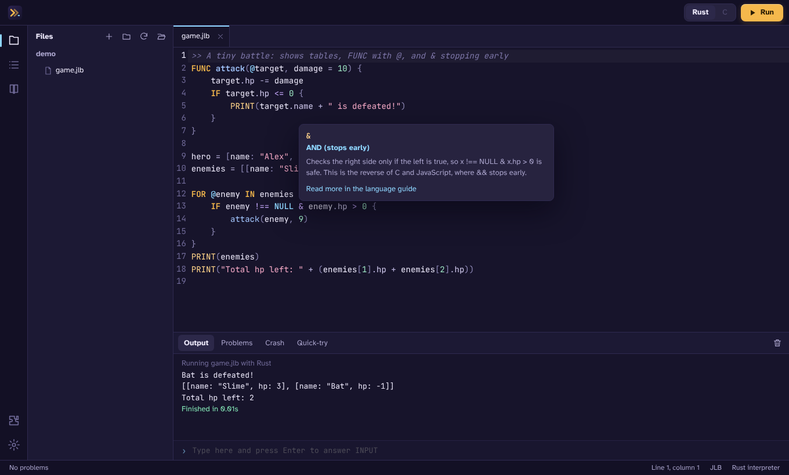
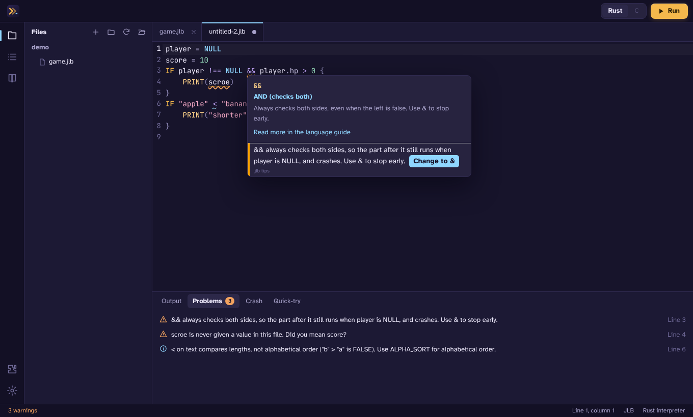
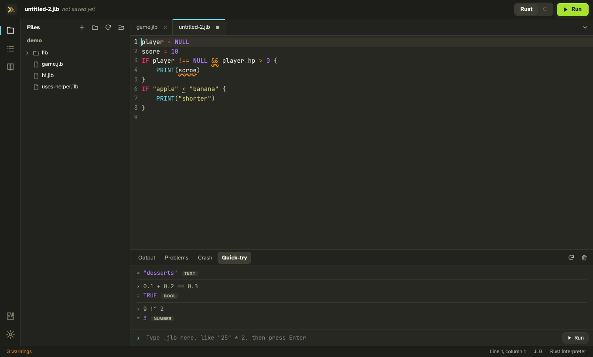
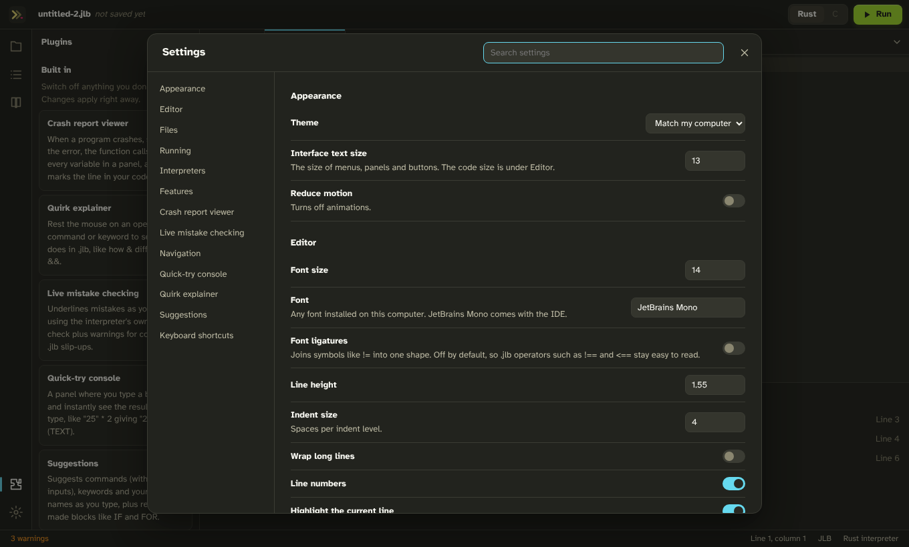

# JLB IDE

A code editor made for the [.jlb programming language](https://github.com/ASDFboy/jlb-rust). Write a program, check it, and run it with the Rust or C interpreter, with tools built around the parts of .jlb that are different from other languages.

**Authors:** [ASDFboy](https://github.com/ASDFboy) and Claude



## What it does

### Tools made for .jlb

- **Live mistake checking.** Problems are underlined as you type, using the interpreter's own syntax check, with one-click fixes for its suggestions (`Print` → `PRINT`, `myScore` → `my_score`, `!=` → `!==`). Every mistake in the file is listed, not just the first, and the Problems panel covers all your open files. It also warns about the .jlb slip-ups other editors can't know about:
  - `x !== NULL && x.hp` crashes when `x` is NULL, because `&&` always checks both sides (the fix changes it to `&`).
  - `"apple" < "banana"` compares lengths, not alphabetical order.
  - A name that's never given a value, with a "did you mean" for typos (`scroe` → `score`).
  - A name used where it doesn't exist: one that's only given a value inside another function, or a `FOR` or `FAIL` name used after its block.
  - A variable or function used above the line that gives it a value (top-level code runs in order).
  - A `GOTO` with no matching `POINT`.
- **Crash report viewer.** When a program crashes, a panel shows the error, the function calls and every variable's value in a table. The crashing line is marked in your code, and resting the mouse on a variable shows what it held when the program crashed.
- **Quirk explainer.** Rest the mouse on any operator, command or keyword for a plain-English explanation: how `&` differs from `&&`, what `!%` and `!^` do, why `!=` is an error, what `0xFF` equals. Your own functions show their inputs, and which ones are shared with `@`.
- **Quick-try console.** Type a bit of .jlb and see the result and its type right away: `"25" * 2` gives `"2525"` (TEXT). Variables carry over between snippets, `INPUT` asks right in the panel, and a snippet stuck in a loop can be stopped. Select code in the editor and press Ctrl+Enter to try it, or load the whole file to try out its functions.
- **Run with Rust or C.** Switch interpreters with one click in the toolbar. Programs that use `INPUT` work: type your answer in the Output panel.
- **The language guide, built in.** The whole .jlb reference in the sidebar, searchable, with a button to open any example as a new file.





### Everyday editing

Files and folders (drag to move them, arrow keys to get around), tabs you can drag into order, error lines in the output that jump to the code, syntax highlighting, suggestions while typing (commands, your own names, a table's entries after `hero.`, and ready-made `IF`, `FOR`, `FUNC` and `TRY` blocks), a hint showing which input you're typing in a command or function call, go to definition (F12 or Ctrl+click), an Outline of functions and `POINT`s, find and replace, a command palette, a Monokai color theme (night and day versions), your folder and files reopened where you left them, and backups of unsaved work: if the IDE or the computer crashes, your unsaved tabs come back the next time you open it (and there's a setting to close without being asked about unsaved changes, keeping them for next time).

### Settings for everything

Every feature can be switched off, and most have their own options: Settings (Ctrl+,) lists them all, with a search box. Keyboard shortcuts can be changed there too. Changes apply right away, with no restart.



### Plugins

Anyone can add features with a plugin: a folder with a `plugin.json` and a `main.js`. Plugins can add commands, panels, sidebar views, mistake checks, hover info, suggestions, settings, and even more interpreters. The built-in features are plugins themselves, built on the same API. **Plugins → Create a plugin** writes a working example to start from (it reloads by itself as you edit it), **Install from a folder** adds someone else's, and [docs/plugins.md](docs/plugins.md) describes everything a plugin can do.

## Good to know

- **The Windows downloads aren't code-signed** (a signing certificate costs money every year), so Windows SmartScreen may warn the first time. Choose **More info → Run anyway**.
- **The C interpreter isn't finished yet.** Once [jlb-c](https://github.com/ASDFboy/jlb-c) exists, point the IDE at it in Settings → Interpreters, and the C button in the toolbar starts working.
- **There's no step-by-step debugger yet.** The crash viewer and Quick-try cover a lot of the same ground.
- **Plugins are trusted code.** They can read and change your files and run programs, like extensions in other editors, so only install plugins you trust.
- **Ready-made downloads are Windows only for now.** On macOS and Linux, [build it from source](#building-from-source).

## Setting it up on Windows

You need Windows 10 or 11. The IDE uses Microsoft Edge WebView2, which comes with Windows; the installer adds it if it's missing.

**With the installer (recommended):**

1. In this repository, open the `windows` folder, click **`JLB-IDE-setup.exe`**, then click the download button (**Download raw file**).
2. Run it. It installs just for your Windows account and needs no admin rights.
3. Start **JLB IDE** from the Start menu.

**Without installing:** download the `windows/portable` folder (the green **Code** button → **Download ZIP**, then unzip it), keep its three parts together, and run `JLB-IDE.exe`.

The Rust interpreter comes with the IDE, so programs run straight away.

### Edit .jlb files with a right-click

In **Settings → Files**, **Edit .jlb files with JLB IDE** adds **Edit with JLB IDE** to the right-click menu of .jlb files. Double-clicking a .jlb file still runs it (if that isn't set up yet on your computer, this sets it up too). **Undo** puts it back to Notepad.

## Using it

1. **Open a folder** (Ctrl+Shift+O) or a file (Ctrl+O), or start a **New file** (Ctrl+N). The welcome screen has examples to try.
2. **Run** with F5. Output appears below. If the program asks for `INPUT`, type in the box at the bottom of the Output panel and press Enter.
3. **Stop** a running program with Shift+F5 or the square button.

| Shortcut | Does |
| --- | --- |
| F5 / Shift+F5 | run / stop |
| Ctrl+Shift+P | show every command |
| Ctrl+, | settings |
| Ctrl+S, Ctrl+Shift+S | save, save as |
| Ctrl+N, Ctrl+O, Ctrl+Shift+O | new file, open file, open folder |
| Ctrl+W, Ctrl+Tab | close file, next file |
| Ctrl+Enter | try the selection (or the current line) in Quick-try |
| Ctrl+Shift+Q | open Quick-try |
| F12 or Ctrl+click | go to where a function, `POINT` or variable is defined |
| Ctrl+G | go to line |
| Ctrl+F | find and replace |
| Ctrl+/ | comment or uncomment lines with `>>` |
| Ctrl+Space | show suggestions |
| Ctrl+F1 | the language guide |
| Ctrl+B, Ctrl+J | show or hide the sidebar, the bottom panel |

## Building from source

You need [Node.js](https://nodejs.org) 18 or newer and [Rust](https://rustup.rs), both free. On Linux, also install Tauri's libraries:

```text
sudo apt install libwebkit2gtk-4.1-dev libgtk-3-dev librsvg2-dev libxdo-dev
```

1. Build the interpreter from [jlb-rust](https://github.com/ASDFboy/jlb-rust) with `cargo build --release`, and copy `target/release/jlb` (`jlb.exe` on Windows) into `src-tauri/interpreters/`.
2. In this folder:

   ```text
   npm install
   npx tauri build
   ```

   The app is in `src-tauri/target/release/`, with installers in `src-tauri/target/release/bundle/`.

**From Linux to Windows:** `scripts/build-windows.sh` cross-builds the installer and the portable folder into `windows/`. It needs the `x86_64-pc-windows-gnu` Rust target, `mingw-w64` and `nsis`, plus a `jlb.exe` built for Windows.

**On GitHub:** the Build workflow (`.github/workflows/build.yml`) builds the Windows installer and Linux packages on GitHub's own machines. Start it from the **Actions** tab (**Build → Run workflow**), or by pushing a tag like `v0.1.0`. The files appear under the run's **Artifacts**.

### Working on the interface in a browser

The interface can run in a normal browser, with a small Node server doing the app's file and interpreter work:

```text
npm run build:web
node scripts/dev-server.mjs
```

Then open <http://127.0.0.1:5180>. `npm run dev:web` rebuilds on every change. The server uses a temporary settings folder unless `JLB_IDE_CONFIG` is set, and the interpreter in `src-tauri/interpreters/` unless `JLB_PATH` is.

### Tests

`npm test` drives the whole interface in a real browser against the real interpreter: running programs with input, stopping them, crash reports, every kind of mistake check, hovers, suggestions, Quick-try, go to definition, switching features off in Settings, plugins, and saving. It needs Chromium for Playwright (`npx playwright-core install chromium`, or set `CHROMIUM_PATH`).

## How it works

JLB IDE is a [Tauri](https://tauri.app) app: a small Rust program that opens a window using the web engine already on your computer (WebView2 on Windows), instead of shipping a whole browser like Electron apps do. That keeps it to a 2 MB installer and modest memory use. The editor is [CodeMirror 6](https://codemirror.net).

It talks to the interpreters through their [editor modes](https://github.com/ASDFboy/jlb-rust/blob/main/docs/09-programs-and-files.md#editor-modes): `jlb --check` for live checking, `jlb --ide` for running (live output and a JSON crash report), and `jlb --repl` for Quick-try. Any interpreter with those modes works with the IDE.

| Path | What's in it |
| --- | --- |
| `src/core/` | the IDE itself: layout, editor, files and tabs, running, settings, commands, language services, the plugin host |
| `src/plugins/` | the built-in features, written as plugins: mistake checking, crash viewer, quirk explainer, Quick-try, suggestions, navigation, language guide |
| `src/lang/` | .jlb highlighting, and what the IDE knows about the language's words and operators |
| `src/docs/` | the language guide (a copy of jlb-rust's `docs/`) |
| `src-tauri/` | the native side: files, running interpreters, settings, plugins folder, Windows file setup |
| `scripts/` | building the interface and the Windows version, and the browser server |
| `tests/` | the interface tests |
| `windows/` | the ready-made Windows installer and portable version |
| `docs/` | the plugin guide and screenshots |

## Authors

Made by **ASDFboy** and **Claude**.
